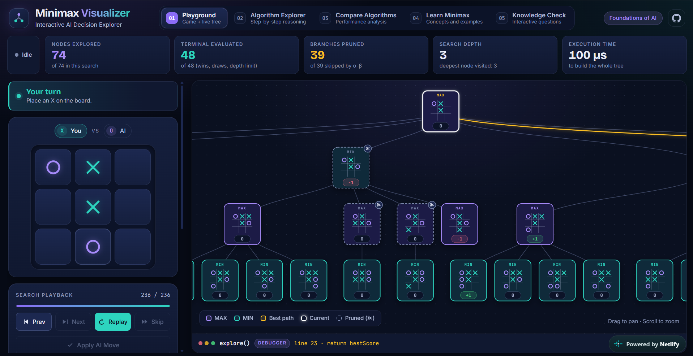

# 🌳 Minimax Visualizer — Interactive AI Decision Explorer

<div align="center">

[](https://react.dev/)
[](https://www.typescriptlang.org/)
[](https://vite.dev/)
[](https://en.wikipedia.org/wiki/Minimax)
[](https://en.wikipedia.org/wiki/Alpha%E2%80%93beta_pruning)
[](https://git-scm.com/)
[](https://github.com/)
[](https://www.netlify.com/)

**🚀 An interactive Tic-Tac-Toe game that visualizes the Minimax algorithm with Alpha-Beta pruning, step by step, in real time.**

[🔴 Live Demo](https://minimaxvisualizerbyarun.netlify.app) 
</div>

---

## 🌟 Project Highlights

> **Learn adversarial search by watching it think.** Play against a Minimax AI, then open up its brain: see every node it visits, every score it backs up, and every branch it prunes.

**🎯 What makes this special:**
- **Real engine, real numbers.** Every statistic, explanation and quiz answer is computed by running the same search code the game uses. Nothing is hard-coded or illustrative.
- **Five learning spaces in one app:** play, explore, compare, learn and test yourself.
- **Step-by-step playback** with Prev / Next / Play / Skip, a draggable timeline and adjustable speed.
- **Plain-English reasoning** for each algorithm step, generated from the actual α/β values and tree.
- **Built-in self-verification.** The Compare page cross-checks its counting engines against the app's engine on every run and shows a warning if anything disagrees.
- **Pseudocode debugger** that highlights the line of `explore()` being executed.

---

## 🖼️ Application Preview

<div align="center">

### 🎮 Playground: Game + Live Decision Tree
*Play X against the AI while its search tree builds node by node*



</div>


---


## 🚀 Key Features

The application has **five main sections**:

| # | Section | Features |
|---|---------|----------|
| 01 | **Playground** | Interactive game against the AI, live game-tree visualization, adjustable depth and animation speed, collapsible pseudocode debugger |
| 02 | **Algorithm Explorer** | Step-by-step algorithm execution, plain-English AI reasoning, execution timeline with five phases, root-candidate scores, 7 preset positions |
| 03 | **Compare Algorithms** | Minimax vs Alpha-Beta: nodes, terminal states, pruned branches, cutoffs, timing, per-depth chart, automatic verification |
| 04 | **Learn Minimax** | Eight structured lessons, each with an interactive demo driven by the real engine |
| 05 | **Knowledge Check** | 12 interactive questions (multiple choice, click-a-cell, multi-select) with explanations quoting real numbers |

### 🎮 Playground
* Play as **X** against the AI (**O**)
* Five difficulty levels set by search depth: **3 Easy · 4 Normal · 5 Hard · 6 Expert · ∞ Unbeatable**
* Live stats dashboard: nodes explored, terminal states evaluated, branches pruned, search depth and execution time
* Pan and zoom the decision tree (drag to pan, scroll to zoom)
* Colour-coded nodes: **MAX** (violet), **MIN** (teal), best path, current node and pruned cutoffs (✂)
* The first AI move (8 empty cells) is played instantly because that tree is too large to animate usefully

### 🔬 Algorithm Explorer
* Load a preset position, choose a depth, and press **Load & search**
* Every step (visit, evaluate, back up α/β, prune, select move) is explained in words
* Drag the timeline to jump anywhere in the search; the tree, stats, reasoning and debugger stay in sync
* Pseudocode debugger highlights the exact line being executed

### 📊 Compare Algorithms
* Runs plain Minimax and Alpha-Beta on the same position, depth and move order
* Metrics: nodes explored, terminal states, branches pruned, cutoffs (β ≤ α), best move, score, mean execution time
* Hand-drawn SVG charts with no chart library
* **10 verification checks** against the app's own engine

### 📚 Learn Minimax
1. Adversarial search
2. Game trees
3. MAX and MIN nodes
4. Terminal state evaluation
5. Minimax score propagation
6. Alpha and beta values
7. Alpha-Beta pruning
8. Complexity and limitations

### ✅ Knowledge Check
* 12 questions across topics: MAX and MIN, terminal evaluation, predict the move, alpha and beta, pruning
* Instant feedback with explanations and a final per-topic score breakdown

---

## 🧠 AI Algorithms Implemented

These are the core algorithms of the project:

| # | Algorithm | Description |
|---|-----------|-------------|
| 1 | **Minimax** | Finds the optimal move assuming the opponent also plays optimally |
| 2 | **Alpha-Beta Pruning** | Optimizes Minimax by eliminating branches that cannot affect the final decision |

### How the engine works

```
explore(node, α, β):
    visit(node)
    if node is terminal (win / draw / depth limit):
        return evaluate(node)            # +1 AI wins · −1 human wins · 0 otherwise
    bestScore = isMax ? −∞ : +∞
    for each empty cell (0 → 8):
        child = makeMove(cell)
        score = explore(child, α, β)
        backpropagate score
        update bestScore, then α (MAX) or β (MIN)
        if β ≤ α:
            prune remaining branches     # ✂
            break
    return bestScore
```

* The AI is always the **maximizing** player at the root
* Cells are searched in a fixed order (0 → 8) with strict `>` / `<` tie-breaking
* Every action is recorded as a **step** (`visit`, `score`, `backpropagate`, `prune`), so the UI can replay, scrub and explain the search

### Measured pruning results (full depth, AI = O to move)

| Position | Minimax nodes | Alpha-Beta nodes | Reduction |
|----------|--------------:|-----------------:|----------:|
| Empty board | 549,946 | 18,297 | ~96.7% |
| After X takes the centre | 55,505 | 2,316 | ~95.8% |

Both algorithms choose the same move with the same score in every case.

---

## 🎓 Important Concepts Demonstrated

- Adversarial search
- Game-tree construction
- MAX and MIN decision-making
- Utility values and terminal states
- Recursive Minimax evaluation
- Alpha and Beta values
- Alpha-Beta pruning condition (β ≤ α)
- Search depth and depth-limited evaluation
- Move ordering
- Nodes explored and pruned
- Algorithm performance comparison

---

## 🛠️ Technologies Used

| Category | Technology |
|----------|-----------|
| Frontend framework | **React 19** (with the React Compiler via Babel) |
| Programming language | **TypeScript 5.9** |
| Build tool | **Vite 8** |
| State management | **Zustand** |
| Tree visualization | **react-d3-tree** |
| Charts and mini-trees | Hand-written **SVG + CSS** (no chart library) |
| Styling | Custom CSS with design tokens (dark "midnight navy" theme) |
| Fonts | Bricolage Grotesque, Inter, JetBrains Mono (Google Fonts) |
| Linting | ESLint 9, typescript-eslint, React Hooks and React Refresh plugins |
| Package manager | npm *(a `pnpm-lock.yaml` is also included)* |
| Version control | Git & GitHub |
| Deployment | Netlify |

---

## 📁 Project Structure

```
Minimax_Visualizer/
│
├── index.html                     # App entry HTML (meta, Open Graph tags)
├── package.json                   # Dependencies and scripts
├── vite.config.ts                 # Vite + React Compiler configuration
├── tsconfig*.json                 # TypeScript configuration
├── eslint.config.js               # Lint rules
│
├── 📁 public/
│   ├── favicon.svg
│   ├── icons.svg
│   └── screenshots/mid-play.png   # README / social preview image
│
└── 📁 src/
    ├── main.tsx                   # React entry point
    ├── App.tsx                    # Layout, tab routing, playback timer
    ├── store.ts                   # Zustand store (game + visualization state)
    ├── minimax.ts                 # Minimax + Alpha-Beta engine, step recorder
    ├── types.ts                   # Shared TypeScript types
    ├── codeLines.ts               # Pseudocode lines for the debugger
    ├── nav.ts                     # Tab definitions
    │
    ├── 📁 views/                  # The five main sections
    │   ├── Playground.tsx
    │   ├── Explorer.tsx
    │   ├── Compare.tsx
    │   ├── Learn.tsx
    │   └── Quiz.tsx
    │
    ├── 📁 components/             # Reusable UI
    │   ├── Board.tsx · Controls.tsx · Header.tsx
    │   ├── TreeVisualizer.tsx · MiniTree.tsx
    │   ├── PlaybackControls.tsx · Timeline.tsx
    │   ├── ReasoningPanel.tsx · CodeDebugger.tsx
    │   ├── StatsBar.tsx · StatusBar.tsx
    │   ├── Charts.tsx · LearnWidgets.tsx · Icon.tsx
    │
    ├── 📁 lab/                    # Analysis layer
    │   ├── search.ts              # Counting engines + verification checks
    │   ├── stats.ts               # Live search statistics index
    │   ├── useSearchStats.ts      # Stats hook
    │   ├── explain.ts             # Plain-English step explanations
    │   ├── fullTree.ts            # Full unpruned tree + layout for lessons
    │   ├── positions.ts           # Preset example positions
    │   └── quiz.ts                # Engine-generated quiz questions
    │
    └── App.css · lab.css · index.css   # Styles
```


## 🔄 Future Enhancements

- [ ] Choose to play first as X or O
- [ ] Configurable AI player and board size
- [ ] Move-ordering heuristics to show how pruning improves
- [ ] Web Worker for heavy comparison runs
- [ ] Keyboard navigation inside the decision tree
- [ ] Additional games (Connect Four, Nim)

---

## 👨‍💻 Author

<div align="center">

**Arun Chinthalapally**
*M.Tech Artificial Intelligence Student @ Amrita Vishwa Vidyapeetham, Coimbatore*
*AI & ML Enthusiast | Python, DSA & SQL | Building AI-powered solutions*

[](https://github.com/arun-248)
[](https://www.linkedin.com/in/arun-chinthalapally-7a254b256)
[](https://arun248-portfolio.vercel.app/)

</div>


**Course context:** Foundations of AI


### ⭐ Star this repo if you found it useful! ⭐

**Made with ❤️ by [Arun Chinthalapally](https://github.com/arun-248) · Built with React · TypeScript · Vite**

[⬆ Back to Top](#-minimax-lab--interactive-ai-decision-explorer)

</div>
